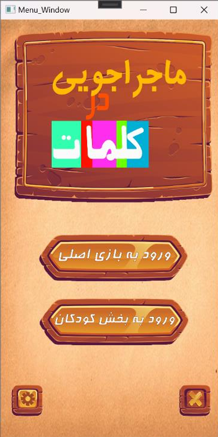
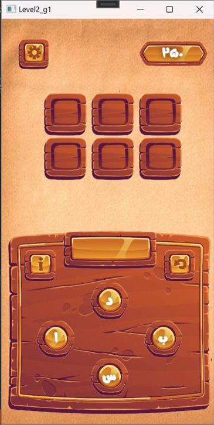
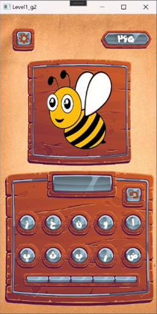

# Word-Adventure-Game
# Adventure in Words (WPF Desktop Game)

An interactive and educational desktop game built with C# and WPF. The game features two distinct modes designed for both adults and children, focusing on vocabulary enhancement and cognitive skills.

## 🎮 Game Modes
*   **Main Game (Adults):** Players are given a set of scrambled letters and must form valid, predefined words. Includes a hint system and letter rotation.
*   **Kids Mode:** Designed for children, this mode displays an image of an object or animal, and the player must spell its name using the provided randomized letters. Features a 5-try scoring system.

## ✨ Features
*   **Custom UI:** Beautiful, custom-styled XAML interfaces with a wooden/rustic theme.
*   **Animations:** Smooth fade-in and fade-out transitions using WPF `DoubleAnimation`.
*   **Audio Integration:** Background music and click sound effects using `MediaPlayer`.
*   **Database-Driven:** Uses a local MS Access database (via ADO.NET) to dynamically load words, images, and save user scores/coins.

## 🛠️ Tech Stack
*   **Language:** C#
*   **Framework:** .NET / WPF
*   **Database:** MS Access (.accdb) with `OleDb` connection
*   **UI/UX:** XAML, Custom Styles, Data Binding

## 📸 Screenshots

## 🚀 How to Run
1. Clone the repository.
2. Open `Adventures_in_words.sln` in Visual Studio.
3. Make sure the database file (`Database1.accdb`) is in the `Resources` folder.
4. Build and Run (F5).
